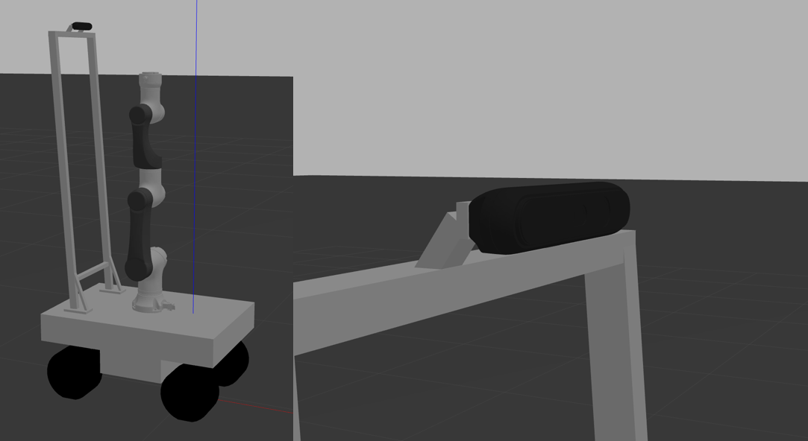
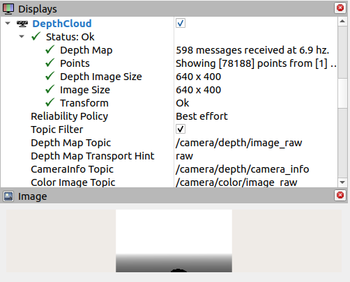

# 百香果采摘移动机械臂仿真

ROS 2 Humble 和 Gazebo Classic 11 工作区，包含四轮独立转向底盘、华研 Elfin E03 六轴机械臂、Gemini 336L RGB-D 相机和底盘六轴 IMU。底盘采用 Ranger Mini 3.0 风格的简化模型，后部双立柱安装厂家 CAD 导出的相机模型。相机沿车体正前方平视，彩色光心距名义地面 1.46 m。



## 启动

在 Ubuntu 22.04 和 ROS 2 Humble 的环境中，安装构建工具和运行依赖。

```bash
sudo apt update
sudo apt install build-essential python3-colcon-common-extensions \
  ros-humble-desktop ros-humble-moveit ros-humble-ros2-controllers \
  ros-humble-gazebo-ros-pkgs ros-humble-gazebo-ros2-control \
  ros-humble-orbbec-description ros-humble-orbbec-camera

./run_e03.sh build
./run_e03.sh mobile
```

`mobile` 启动 Gazebo、车体控制器、MoveIt 2 和 RViz。默认使用 ROS 域 62，Gazebo 主服务端口 11356。移动仿真的查看工具可以通过同一个启动脚本进入对应 ROS 域。

```bash
./run_e03.sh mobile-cli ros2 topic list --no-daemon
./run_e03.sh mobile-cli ros2 control list_controllers
```

在第二个终端运行 `./run_e03.sh teleop` 后，`w/s` 控制前后移动，`a/d` 横移，`q/e` 原地旋转，空格停车。

`./run_e03.sh` 单独启动 E03 仿真。`./run_e03.sh gemini336l` 在 ROS 域 64 调用厂家的 USB 驱动启动文件。整车仿真使用 Gazebo RGB-D 传感器，USB 真机出图待实体相机接入后验证。

## 相机和底盘接口

| 话题 | 数据 |
| --- | --- |
| `/camera/color/image_raw` · `/camera/color/camera_info` | 彩色图及内参 |
| `/camera/depth/image_raw` · `/camera/depth/camera_info` | 深度图及内参，深度值为米 |
| `/camera/depth/points` | 点云 |
| `/imu/data_raw` | 底盘加速度和角速度 |
| `/odom` · `/cmd_vel` | 底盘轮式里程计和速度指令 |

仿真彩色图和深度图分辨率均为 640×400，设置帧率为 15 Hz。RViz 默认显示彩色图、深度图和点云。深度预览以 0.17–6 m 映射为灰度。



## 厂家来源

- 机械臂源码取自华研 `elfin_robot_ros2` 的 `humble_ethercat` 分支，基线为 `1381e3f6d404eaf3311cae4311641e4d8f369b1a`，包含本工作区的 E03 仿真和 Humble 构建修改。源码和原许可文件保存在 `src/elfin_robot_ros2`。[华研上游](https://github.com/huayan-robotics/elfin_robot_ros2/tree/humble_ethercat)
- 相机模型基于奥比中光 Gemini 336L V1.0 原版 STEP，`vendor/orbbec` 记录了厂家下载地址、原件哈希和 STL 转换方式。[相机 CAD 来源](vendor/orbbec/README.md)
